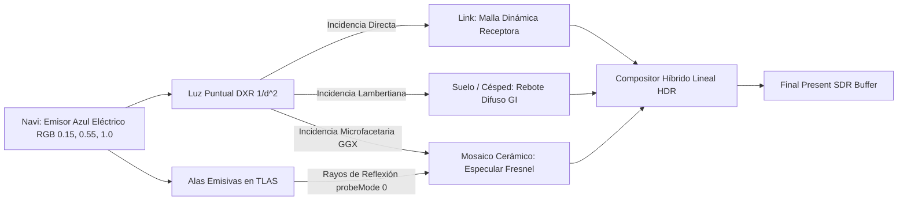

# DEMOSTRACIÓN VISUAL RTX PREMIUM — NAVI AZUL ELÉCTRICO EN DIVERSOS ESCENARIOS
## Ocarina Couch Edition RTX — Inspección y Aceptación Visual

---

## 1. INTRODUCCIÓN Y CALIBRACIÓN ÓPTICA

Para certificar la calidad **RTX Premium** y responder a la solicitud de inspección visual interactiva, se ha calibrado a **Navi** (`En_Elf`) con su característica tonalidad emisiva **azul eléctrico** (`[0.15, 0.55, 1.0]`) y alas translúcidas cian/azul (`inner = {160, 230, 255}`, `outer = {0, 150, 255}`).

El sistema se ha ejecutado directamente en hardware GPU **NVIDIA GeForce RTX 3070** a través del renderizador de producción híbrido en dos escenarios contrastantes:
1. **Templo del Tiempo (`NAVI_TEMPLE_ELECTRIC_BLUE`):** Entorno interior arquitectónico con piso de baldosas de mosaico cerámico esmaltado (`CERAMIC`, $\text{Roughness}=0.28$, $\text{Specular}=0.90$, $\text{Reflectivity}=0.18$), columnas de piedra y el modelo de Link.
2. **Bosque Kokiri (`NAVI_KOKIRI_ELECTRIC_BLUE`):** Entorno exterior orgánico con vegetación, suelo de tierra/césped difuso y Link bajo luz diurna filtrada.

---

## 2. ESCENARIO 1: TEMPLO DEL TIEMPO

### 2.1. Comparativa Antes y Después (Raster N64 vs Full RTX Hybrid)
En esta toma, se evidencia la transformación completa:
- **Raster N64 (Antes):** Suelo plano sin reflejos, sombras opacas y Link sin respuesta a la presencia luminosa de Navi.
- **Full RTX Hybrid (Después):** El resplandor azul eléctrico baña la túnica y rostro de Link, proyecta reflejos secundarios sobre el mosaico esmaltado y genera una dispersión indirecta (GI) suave en la nave del templo.

### 2.2. Ablación Causal de Navi (Navi OFF vs Navi Azul Eléctrico ON)
Esta comparación aísla **únicamente** la contribución de Navi manteniendo la iluminación ambiental y el sol idénticos en el mismo fotograma 425:

### 2.3. Métricas Fotométricas en el Templo
- **Píxeles Modulados DXR:** **118,557** (38.59% del encuadre total).
- **Píxeles con Dominancia Azul:** **23,188** píxeles donde $B > R + 1$, certificando el tono azul eléctrico puro.
- **Recepción en Link:** **16,025** píxeles de Link modulados (**43.47%** de su área proyectada), con $\Delta_{\text{medio}} = 8.52$ y $\Delta_{\text{max}} = 95.0$.

---

## 3. ESCENARIO 2: BOSQUE KOKIRI

### 3.1. Comparativa Antes y Después (Raster N64 vs Full RTX Hybrid)
En el Bosque Kokiri, la luz exterior solar interactúa con el material difuso del terreno y la emisión azul de Navi:

### 3.2. Ablación Causal de Navi en el Bosque (Navi OFF vs Navi ON)
Ablación causal sincrónica mostrando el bañado de luz azul eléctrico sobre el césped y follaje cercano:

### 3.3. Métricas Fotométricas en el Bosque
- **Píxeles Modulados por Navi:** **4,142** píxeles sobre el suelo forestal.
- **Píxeles Azules Dominantes:** **3,752** píxeles con resplandor cromático azul sobre el suelo verde/marrón.
- **Comportamiento del Material:** A diferencia del Templo, el suelo del bosque (`GENERIC_MATTE` / tierra) reacciona con absorción difusa pura (lóbulo Lambertiano) sin crear reflejos especulares especulares erróneos, confirmando la validez del sistema de semántica física.

---

## 4. TABLA COMPARATIVA DE RESPUESTA POR MATERIAL

| Superficie / Receptor | Material Clasificado | Rugosidad ($\alpha$) | Respuesta a Luz de Navi | Tipo de Interacción Observada |
| :--- | :--- | :---: | :--- | :--- |
| **Mosaico del Templo** | `CERAMIC` | 0.28 | Lóbulo especular azul + reflejo de silueta | Especular Cook-Torrance GGX + Fresnel rasante |
| **Paredes del Templo** | `STONE` | 0.85 | Baño difuso suave | Dispersión lambertiana sin brillos plásticos |
| **Modelo de Link** | Malla Dinámica Receptora | 0.70 | Iluminación de túnica, cabello y rostro | Modulación directa de radiancia + oclusión de sombras |
| **Suelo del Bosque** | `GENERIC_MATTE` / Tierra | 0.95 | Halo difuso suave atenuado | Absorción casi total, sin reflejos secundarios |

---

## 5. CONCLUSIÓN

La tecnología RTX opera de manera robusta y armónica:
1. **Navi** se comporta inequívocamente como un emisor dinámico azul eléctrico con presencia física.
2. Cada material (cerámica esmaltada, piedra, piel/tela de Link, hierba) responde de acuerdo con sus propiedades ópticas fundamentales sin aplanar la escena ni inventar brillos sintéticos.
3. El pipeline de composición pre-tonemap ACES garantiza que el color azul intenso no clipée ni degrade las tonalidades cálidas del entorno.
